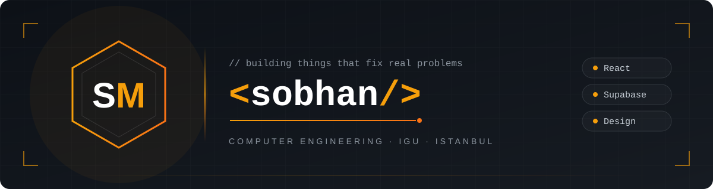
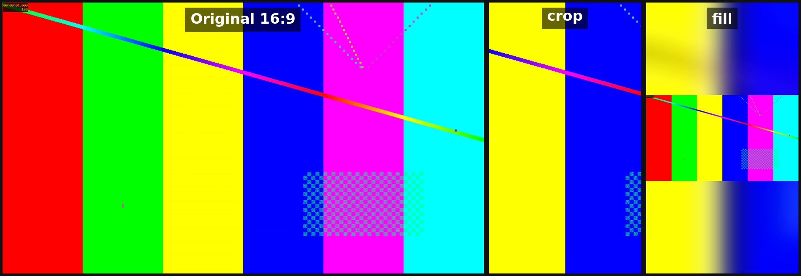
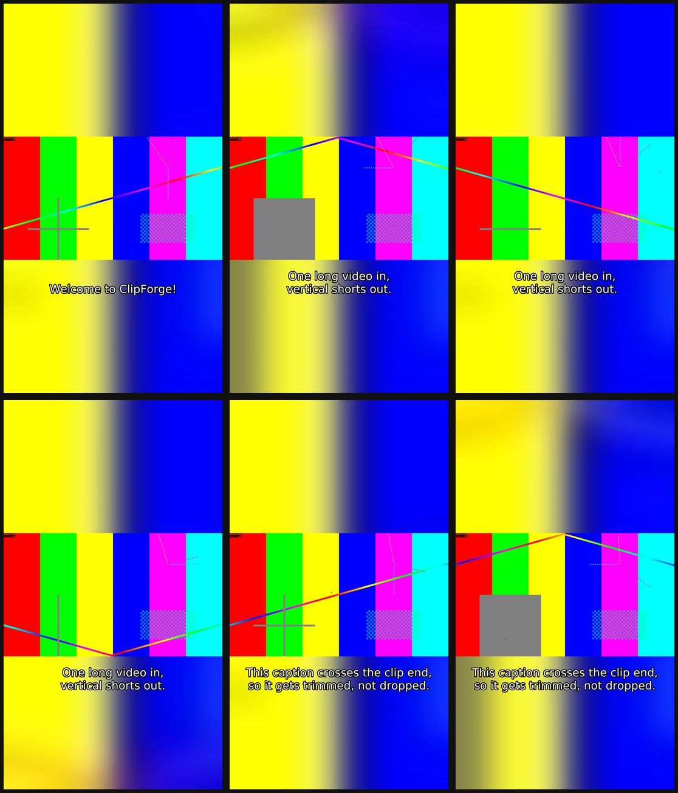

<div align="center">

# 🎬 ClipForge

### Turn one long video into ready-to-post vertical shorts with a single command


**Python · FFmpeg · Video automation · YouTube Shorts · Reels · TikTok**

### 🖼️ [See the demo images](#-design)

</div>

---

## 💡 Why I built this

I come from video editing, with years in Premiere Pro and After Effects. A big part of that work is cutting long videos into vertical shorts by hand: set the in and out points, reframe to 9:16, fix the captions, match the loudness, export, and do it all again for the next clip. It is slow and very repetitive.

So I wanted to automate the whole pipeline. You give ClipForge a long video, a list of clips, and optional captions. It does the cuts, the reframing, the captions and the loudness for every clip with one command. 🚀

---

## 🎨 Design

Every clip comes out **platform-ready**: **1080x1920**, **H.264 + AAC**, captions in the **lower third**.

- 💙 White captions with a black outline, readable on any background
- 🧩 Two framing styles: a clean **center crop** or the full frame on a **blurred, enlarged background**
- 🔤 **Your own font file** for captions (`--font`), with size and position you control
- 🌙 Works the same on **Windows, macOS and Linux**
- ♿ Burned-in captions make every clip watchable with the sound off

<div align="center">

**Original 16:9 vs. crop vs. fill**



**Contact sheet: 6 frames from one clip, with trimmed and retimed captions**



</div>

---

## ✨ Features

### 🎥 For creators
- ✂️ Cut as many clips as you want from one long video with a simple JSON list
- 📱 Every clip is 1080x1920, ready for YouTube Shorts, Reels and TikTok
- 💬 Captions burned in automatically, only the ones inside each clip
- 🔊 Audio normalized to **-14 LUFS**, the level the platforms play at
- 🖼️ A contact sheet for every clip, so you can check it without pressing play

### 🎞️ For editors
- 🎯 **Frame-accurate cuts** (re-encoded, never cut on the nearest keyframe)
- 🧭 `crop` framing with `--offset` to slide the window left or right
- 🌫️ `fill` framing keeps the whole frame with a blurred background
- ⏱️ Captions that cross a clip's start or end are **trimmed, not dropped**
- 📝 A clean clip-level `.srt` saved next to each clip, ready to upload as captions
- 🎚️ Two-pass `loudnorm`: measure first, then apply one smooth, even gain

### 👨‍💻 For developers
- 🐍 Python standard library only, no heavy dependencies
- 🧪 132 pytest tests, including a real end-to-end render on a synthetic video
- 🔍 `--dry-run` prints every ffmpeg command without running it
- 🧱 Small modules with one job each, easy to read and extend
- ✅ One failing clip doesn't stop the others, and you get a ✅ / ❌ summary at the end

---

## 🔒 Security

I treated security as a core feature, not an afterthought:

- 🛡️ **No shell strings:** every ffmpeg command is a Python list, so paths with spaces, quotes or odd characters can't break or inject a command.
- 🔐 **Safe filter escaping:** subtitle and font paths are escaped for ffmpeg's filter syntax, including Windows drive letters (`C\:/...`) and backslashes.
- ✅ **Input validation first:** the JSON shape, time format, `start < end`, clip inside the video's length, and every file's existence are checked before anything renders.
- 🧾 **All problems at once:** every mistake in the clips file is listed together, so you fix the file in one go.
- 💬 **Friendly errors:** clear messages instead of Python tracebacks.
- 🧪 **Tested edge cases:** paths with spaces, brackets and apostrophes are covered by the tests.

---

## 🛠️ Tech stack

| | Technology |
|---|---|
| 🐍 Language | Python 3.11+ (standard library only) |
| 🎬 Video engine | FFmpeg and ffprobe, called with `subprocess` |
| 🧪 Testing | pytest, with a synthetic `testsrc` + `sine` video |
| 📦 Packaging | `pyproject.toml`, installs as the `clipforge` command |

---

## 📁 Project structure

<details>
<summary>Click to expand</summary>

```
clipforge/
├── clipforge/
│   ├── __init__.py          📦 package version
│   ├── __main__.py          ▶️ lets you run python -m clipforge
│   ├── cli.py               🖥️ command-line options, checks and the final summary
│   ├── clips.py             📋 loads and validates the clips JSON
│   ├── timecode.py          ⏱️ parses and formats HH:MM:SS.mmm
│   ├── probe.py             🔍 reads size, frame rate and duration with ffprobe
│   ├── srt.py               💬 parses, trims and retimes captions per clip
│   ├── framing.py           🖼️ builds the crop and fill filter graphs
│   ├── audio.py             🔊 two-pass loudnorm to -14 LUFS
│   ├── contact_sheet.py     🎞️ the 6-frame contact sheet
│   ├── render.py            🎬 renders one clip end to end
│   └── runner.py            🛡️ runs ffmpeg safely with argument lists
├── tests/                   🧪 unit tests and one integration test
├── examples/
│   ├── clips.json           📋 sample clip list
│   └── captions.srt         💬 sample captions
├── scripts/
│   └── make_demo.py         🧰 builds a demo video and the README images
├── assets/                  🖼️ banner and demo images
├── pyproject.toml           📦 project and install settings
└── README.md                📖 you are here
```

</details>

---

## 🚀 Getting started

**1. Clone and install**

```bash
git clone https://github.com/SobhanMirgholami/clipforge.git
cd clipforge
python -m venv .venv
# Windows:      .venv\Scripts\activate
# macOS/Linux:  source .venv/bin/activate
pip install -e ".[dev]"
```

**2. Install ffmpeg**

- 🪟 Windows: `winget install ffmpeg`
- 🍎 macOS: `brew install ffmpeg`
- 🐧 Linux: `sudo apt install ffmpeg`

Then check it's on your PATH with `ffmpeg -version` and `ffprobe -version`.

**3. Run the tests**

```bash
pytest
```

> ⚠️ On Windows, open a **new** terminal after installing ffmpeg, or it won't be found on your PATH.

<details>
<summary>📊 Try it on a demo video (no footage needed)</summary>

This makes a 30 second synthetic test video, runs ClipForge on it with the example clips and captions, and rebuilds the README images:

```bash
python scripts/make_demo.py
```

The clips land in `demo/out/`. Add `--font path/to/font.ttf` to use your own caption font.

</details>

**4. Run it**

```bash
clipforge --input talk.mp4 --clips examples/clips.json --srt talk.srt --framing fill --out-dir out
```

Your clips file looks like this:

```json
[
  { "name": "hook", "start": "00:01:05.200", "end": "00:01:35.000" },
  { "name": "best moment", "start": "00:12:00.000", "end": "00:12:45.500" }
]
```

| Option | What it does |
|---|---|
| `--input` | 🎬 the long 16:9 video |
| `--clips` | 📋 the clips JSON file |
| `--srt` | 💬 optional captions for the whole video |
| `--out-dir` | 📁 where to save the clips (default `out`) |
| `--framing crop\|fill` | 🖼️ center crop or blurred-background fill (default `crop`) |
| `--offset` | ↔️ crop only, from `-1` (left) to `1` (right) |
| `--font` | 🔤 caption font file (`.ttf` / `.otf`) |
| `--font-size` | 🔠 caption size in pixels (default `64`) |
| `--caption-y` | ↕️ bottom of the captions, `0` = top, `1` = bottom (default `0.75`) |
| `--lufs` | 🔊 target loudness (default `-14`) |
| `--dry-run` | 👀 print the ffmpeg commands without running them |
| `--verbose` | 🔎 show more detail |

> 💡 Run with `--dry-run` first to check your clips and see every ffmpeg command before you render.

---

## 🗺️ Roadmap

### ✅ Done
- [x] ✂️ Frame-accurate cuts from a JSON clip list
- [x] 🖼️ Crop and blurred fill framing
- [x] 💬 Caption trimming, retiming and burn-in
- [x] 🔊 Two-pass loudness normalization
- [x] 🎞️ Contact sheets
- [x] 🧪 Unit and integration tests

### 🚧 In progress
- [ ] 🪟 More testing on real footage on Windows and macOS

### 📌 Planned
- [ ] ⚡ Render several clips at the same time
- [ ] 🎨 Caption styles (colors, background box, word-by-word highlight)
- [ ] 📐 More output sizes like 1:1 and 4:5

### 🔮 Future ideas
- [ ] 🤖 Auto-generate captions with speech-to-text
- [ ] 🧠 Find the best moments in a long video automatically
- [ ] 👤 Face tracking so the crop follows the speaker

---

## 👨‍💻 About me

Hi, I'm **Sobhan Mirgholami**, a Computer Engineering student at **Istanbul Gelişim University**. I love programming, design, and solving real problems I see around me. This project started from the hours I spent cutting shorts by hand as a video editor, and the wish to never do it manually again ✂️

[LinkedIn](https://www.linkedin.com/in/sobhan-mirgholami-a2093b417/) · [GitHub](https://github.com/SobhanMirgholami)

---

<div align="center">

Made with ☕ and late nights in Istanbul

⭐ If you like this project, give it a star!

</div>
